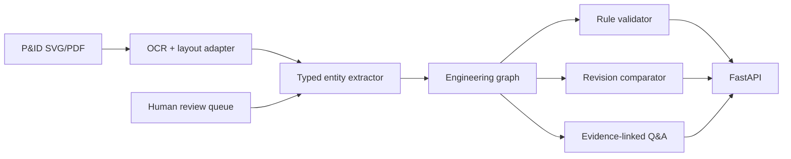

# P&ID Engineering-Document Intelligence

> A revision-aware, evidence-linked document intelligence service for plant engineers.

This project turns a simplified P&ID revision into a structured engineering graph. It extracts equipment, lines, valves, instruments, and relationships, compares drawing revisions, applies transparent validation rules, and answers narrow questions with page-region evidence.

It is inspired by my plant-design exposure at Engineers India Limited, including AutoCAD layouts, piping drawings, ASME/IS standards, CAESAR II, and fabrication-readiness checks. The repository uses **authored synthetic P&ID sheets and metadata**. It contains no client drawings or confidential engineering information.

## Why this is more than a PDF chatbot

A normal document chatbot treats a P&ID as paragraphs. This system treats it as a **diagram plus a graph plus a revision-controlled engineering artifact**.

It can answer:

> “What is connected to pump P-101 in revision B?”

with a structured path such as:

```text
P-101 → discharge line L-201 → isolation valve V-201 → cooler E-101
```

It can also explain:

- which entities changed between revisions;
- whether a line has a dangling endpoint;
- which page and bounding box support an extracted entity; and
- when an uncertain extraction needs human review.

## System design



The current demo uses a deterministic source-layer adapter over synthetic SVG metadata so it can run without commercial OCR or an LLM key. The interfaces are intentionally shaped so an OCR or multimodal model can be added later without changing the graph, validation, API, or evaluation layers.

## Quickstart

```bash
python3 -m venv .venv
source .venv/bin/activate
pip install -e '.[dev]'
python scripts/run_evaluation.py
python -m uvicorn pid_intel.api:app --reload
```

Open `http://127.0.0.1:8000/docs`.

## Endpoints

```bash
curl http://127.0.0.1:8000/health
curl http://127.0.0.1:8000/documents/rev-b/extract
curl http://127.0.0.1:8000/documents/compare?base=rev-a\&candidate=rev-b
curl 'http://127.0.0.1:8000/documents/rev-b/ask?q=What%20is%20connected%20to%20P-101?'
```

## Evidence model

Every extracted item contains:

- document ID;
- revision;
- entity type and tag;
- page number;
- normalized bounding box;
- source text;
- extraction confidence; and
- review status.

The API does not return a confident-looking answer without a trace to the source entity or relationship. Low-confidence or safety-sensitive items are marked `needs_review`.

## Results

Run:

```bash
python scripts/run_evaluation.py
```

The output is saved to [`reports/evaluation.json`](reports/evaluation.json). The evaluation covers:

- entity extraction precision and recall on the synthetic gold set;
- relationship-path correctness;
- revision-change recall, including deleted entities;
- validation-rule behavior for dangling connections;
- evidence-linked answer structure; and
- API contract behavior.

The data is intentionally small and synthetic. The results demonstrate reproducibility and software behavior, not production drawing-recognition accuracy.

## Development story

The Git history records a real debugging path:

1. Create a typed extraction contract and synthetic revision pair.
2. Implement the first graph and revision comparator.
3. Discover that deleted entities were invisible because the comparator only iterated candidate entities.
4. Add a failing regression test, diagnose the set-difference mistake, and fix the comparator.
5. Add validation rules, API contracts, evaluation output, and CI.

The failure transcript is preserved in [`reports/debug/deleted-entity-failure.txt`](reports/debug/deleted-entity-failure.txt).

## Limitations and responsible use

- Synthetic SVGs and metadata only; no confidential plant drawings are included.
- This baseline does not claim to perform full OCR or symbol recognition on arbitrary scanned drawings.
- Engineering validation rules are illustrative and must be reviewed against project standards.
- The service is decision support, not a design approval or safety certification system.
- A production system would need access control, document classification, version governance, audit logs, calibrated confidence, human approval, and domain validation.

## Skills demonstrated

Python, typed schemas, graph modeling, document intelligence, multimodal-system architecture, information extraction, revision comparison, rule-based validation, FastAPI, API contracts, testing, evaluation, evidence traceability, Git/GitHub, and production-minded documentation.
